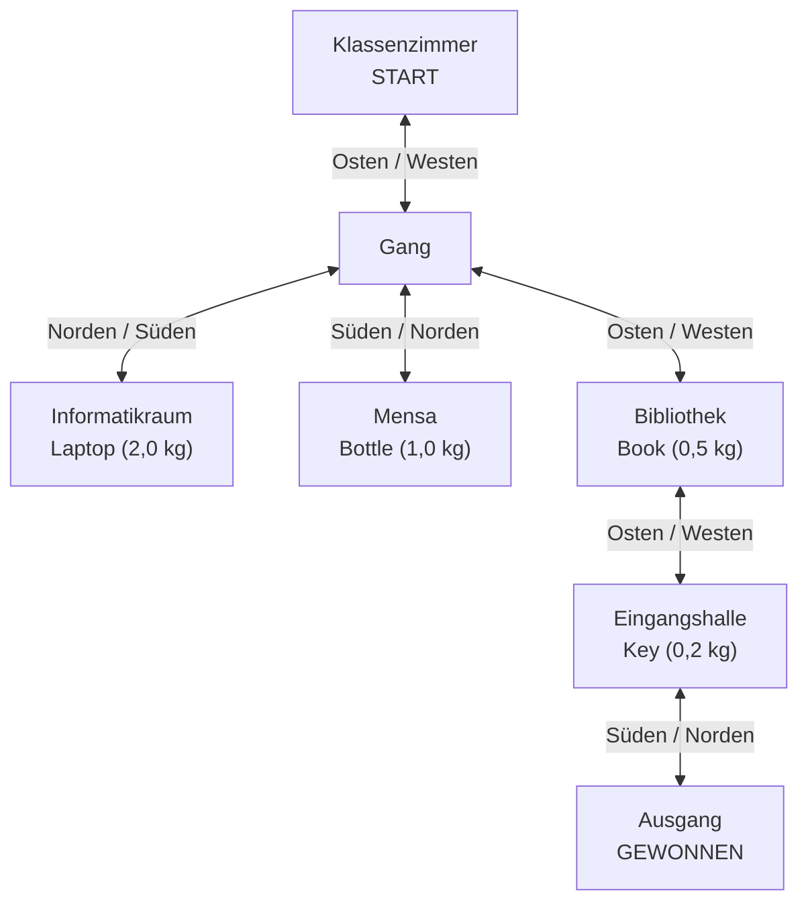

# Raumplan – Zork 2 Schulabenteuer

Die Pfeile entsprechen den Richtungsbefehlen `go north`, `go east`, `go south` und `go west`. Der Spieler beginnt im Klassenzimmer. Der Ausgang ist der Gewinner-Raum.

**Gewinnweg:** `go east` → `go east` → `go east` → `go south`.

Die Befehle `back`, `map`, `take`, `drop` und `inventory` können unterwegs genutzt werden.
